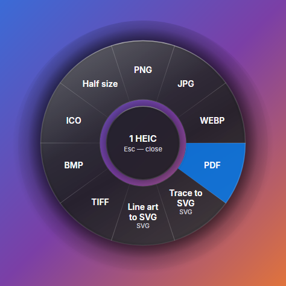
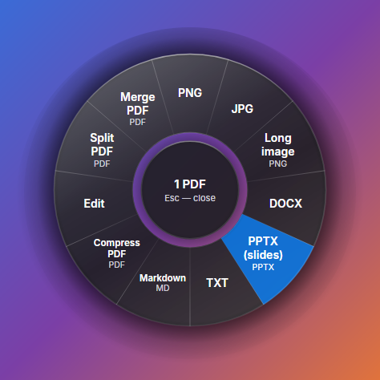
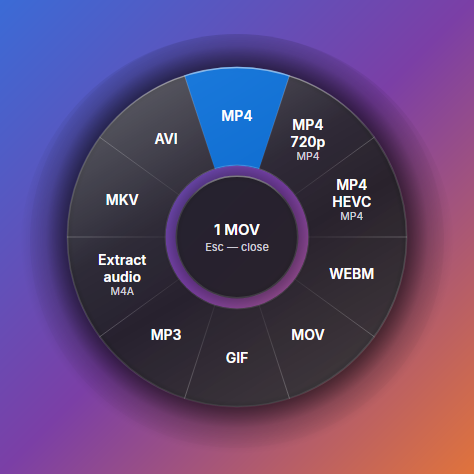

# Filee Lite

A lighter macOS (Apple Silicon) build of [Filee](https://github.com/KnifeLemon/Filee) by Myeonggu Kim (KnifeLemon), MIT licensed.

Hold <kbd>Option</kbd>, drag files and drop them on a format in the donut that opens at the cursor. The donut, the
`filee` command line tool and watch folders are the upstream ones; this fork keeps only the formats people use every day.

> This is a fork for personal use. For the full Windows, Linux and macOS app with all 244 formats, use
> [upstream Filee](https://github.com/KnifeLemon/Filee). Nothing here is sent to upstream, and Filee Lite never updates
> itself from it.

## The donut

Liquid Glass look (rendered headless, so the system blur is not visible here):

<p>
  
  
  
</p>

The classic slices stay available in Settings > Theme. On macOS an experimental switch there puts the system blur
under the ring; without it the glass is dense enough to read on any background.

## What is in it

| Group | Formats | Engine |
|---|---|---|
| Images | PNG, JPG, WEBP, HEIC, AVIF, GIF, TIFF, BMP, ICO, SVG | built in |
| PDF | to images, to DOCX, merge, split, compress, crop, page editor | built in |
| Documents | DOCX, DOC, ODT, RTF | built in; DOC and ODT through LibreOffice |
| Spreadsheets | XLSX, XLS, CSV | built in; XLS through LibreOffice |
| Presentations | PPTX, PPT | built in; PPT through LibreOffice |
| Text | TXT, MD, HTML | built in |
| Video | MP4, MOV, MKV, WEBM, AVI, M4V | FFmpeg |
| Audio | MP3, M4A, WAV, FLAC, OGG, OPUS, AAC | FFmpeg |
| Archives | ZIP, 7Z, RAR, TAR, TGZ, GZ, extract to a folder | 7-Zip (bundled) |

Text recognition (searchable PDF) uses Apple Vision and downloads nothing.

## What was removed

HWP/HWPX, e-books, CAD, 3D models, geospatial data, fonts, subtitles, structured data (JSON, YAML, XML, ...), e-mail,
OFD, camera RAW and other rare image, video, audio and archive formats, and their engines: rhwp, Unhwp, Pandoc, calibre,
Ghostscript, Tesseract, the Java runtime and H2Orestart. The donuts for these formats are gone too. Update checks are
off, so the app never replaces itself with the upstream release.

## Install

1. Download `Filee-<version>-osx-arm64.dmg` from [Releases](../../releases).
2. Open it and drag Filee to Applications.
3. First launch: System Settings > Privacy & Security > **Open Anyway** (the build is not notarized).
4. For the Option + drag gesture: System Settings > Privacy & Security > **Accessibility** > enable Filee. After a
   reinstall, remove the entry with the minus button and add it again.

The `.tar.gz` in the same release has `install.sh`, which also links the `filee` command into `~/.local/bin`.

LibreOffice (about 300 MB) is needed only for DOC, XLS, PPT and ODT; install it from Settings > Engines when needed.

## Build

Needs the .NET 10 SDK (see `global.json`).

```sh
dotnet build Filee.slnx
dotnet test tests/Filee.Core.Tests
```

The macOS package is built by GitHub Actions (`.github/workflows/mac-lite.yml`, `macos-15`) with
`pwsh build/build-portable.ps1 -Runtime osx-arm64`. A push to `main` publishes a release named after the version in
`Directory.Build.props`.

## License

MIT, see [LICENSE](LICENSE). Third-party components are listed in [THIRD-PARTY-NOTICES.md](THIRD-PARTY-NOTICES.md).
Copyright (c) Filee contributors; the original project is by Myeonggu Kim (KnifeLemon).
